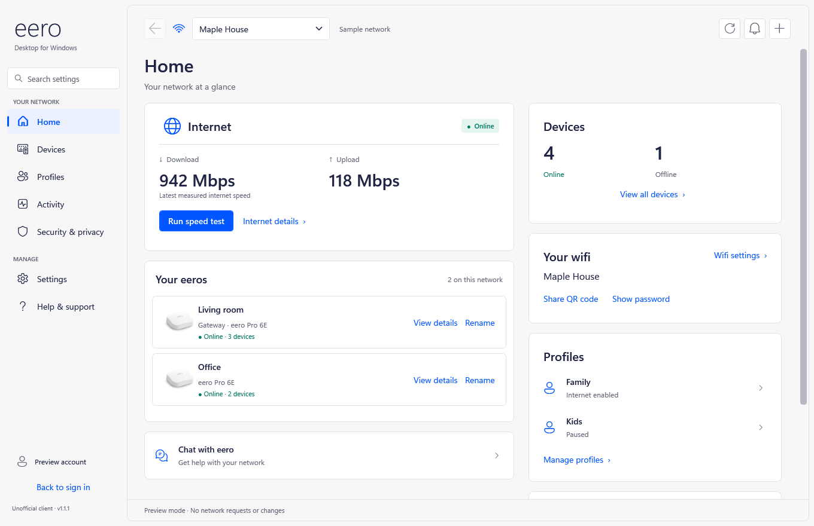
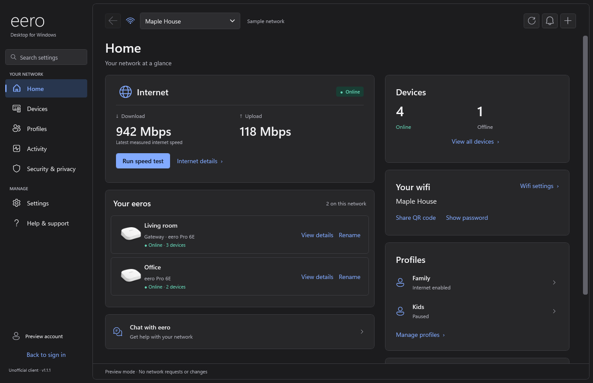
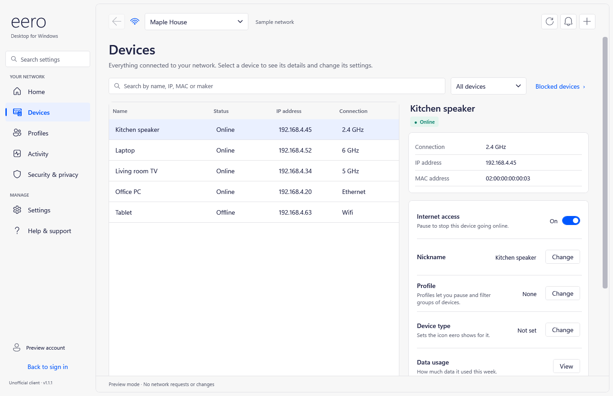
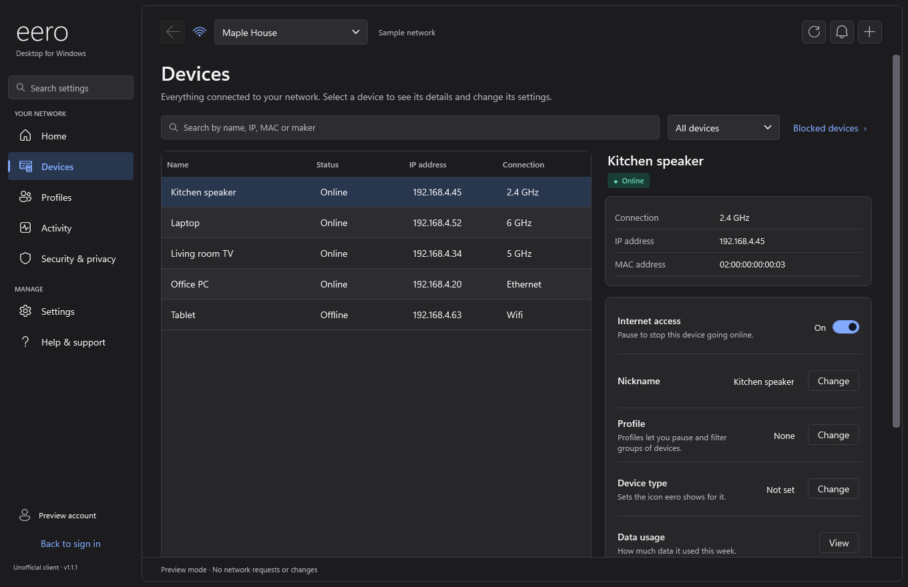
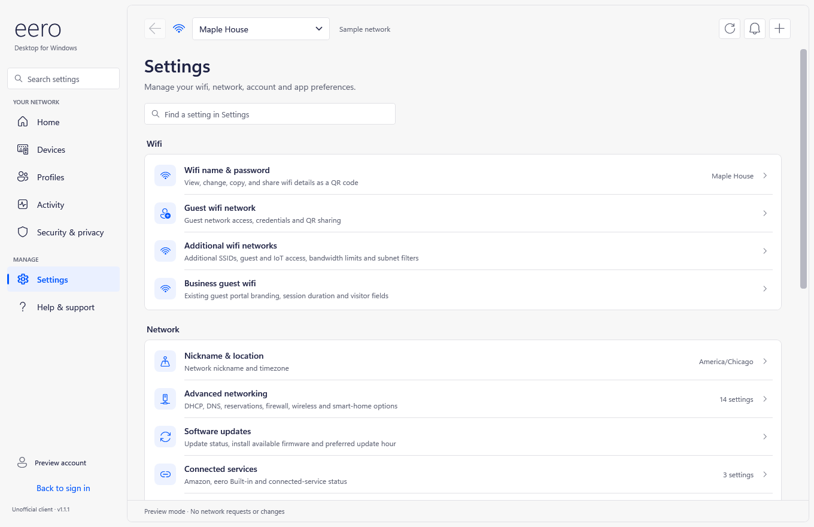
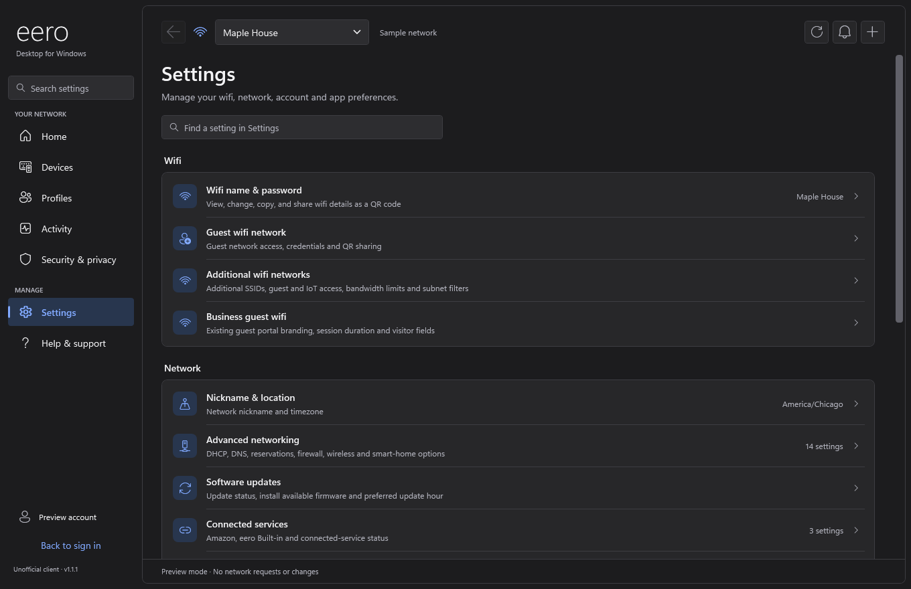

# eero Desktop (Unofficial) — v1.1.0

An independent, native desktop app for managing an eero network on **Windows, Linux and macOS**. It has a desktop layout, light and dark themes, device artwork, and Amazon or email/phone sign-in.

Made by: **Carlos B. (Los33)**

This project is not affiliated with or endorsed by Amazon or eero. Feature availability depends on your hardware, account permissions and service entitlements. See [FEATURE-COVERAGE.txt](FEATURE-COVERAGE.txt) for the feature catalog and current limitations.

| Platform | Built with | Packages |
| --- | --- | --- |
| Windows 10 / 11 | C# 5, .NET Framework 4.8, WPF, WebView2 | `.zip` |
| Linux (x64, ARM64) | C# / .NET 10, GTK 4 + libadwaita, WebKitGTK | `.deb`, AppImage, `.tar.gz` |
| macOS 13+ (Apple silicon, Intel) | Swift, SwiftUI + AppKit, WKWebView | universal, arm64 and x86_64 `.app` zips |

## Screenshots

| Light | Dark |
| --- | --- |
|  |  |
|  |  |
|  |  |

More in [screenshots/](screenshots/).

## Download

Get the latest build from the [Releases page](https://github.com/Los33c/unofficial_eero_desktop_native/releases/latest).

| System | File |
| --- | --- |
| Windows | `eero-Desktop-1.1.0-windows.zip` |
| Debian / Ubuntu (Intel/AMD) | `eero-desktop_1.1.0_amd64.deb` |
| Debian / Ubuntu (ARM) | `eero-desktop_1.1.0_arm64.deb` |
| Any Linux (Intel/AMD) | `eero-desktop-1.1.0-x86_64.AppImage` or `eero-desktop-1.1.0-linux-x64.tar.gz` |
| Any Linux (ARM) | `eero-desktop-1.1.0-aarch64.AppImage` or `eero-desktop-1.1.0-linux-arm64.tar.gz` |
| macOS (any Mac) | `eero-Desktop-1.1.0-macOS-universal.zip` |
| macOS (one kind of Mac) | `eero-Desktop-1.1.0-macOS-arm64.zip` (Apple silicon) or `-x86_64.zip` (Intel) |

Each platform's release includes a `SHA256SUMS` file for checking downloads.

## Install and run

### Windows

Requires Windows 10 or 11 (64-bit), .NET Framework 4.8 and the Microsoft Edge WebView2 Runtime.

Extract the **entire** zip and open `EeroDesktop.exe`. Keep its DLLs, `EeroDesktop.exe.config` and the `runtimes` folder together. Close older copies first. Network management does not need administrator rights; installing and connecting the optional VPN component asks for Windows administrator approval.

### Linux

Requires x86_64 or ARM64 Linux with a graphical desktop (X11 or Wayland), GTK 4.12+, libadwaita 1.5+, WebKitGTK 6.0, libsecret and ICU. This covers Ubuntu 24.04+, Debian 13+, Fedora 40+, openSUSE Tumbleweed and Arch. The .NET runtime is included, so you don't need to install it.

```bash
# Ubuntu / Debian
sudo apt install libgtk-4-1 libadwaita-1-0 libwebkitgtk-6.0-4 libsecret-1-0
# Fedora
sudo dnf install gtk4 libadwaita webkitgtk6.0 libsecret
# Arch
sudo pacman -S gtk4 libadwaita webkitgtk-6.0 libsecret
```

Then pick one package:

| Package | How to install |
| --- | --- |
| `.deb` | `sudo apt install ./eero-desktop_1.1.0_amd64.deb` (also installs the dependencies; remove with `sudo apt remove eero-desktop`) |
| AppImage | `chmod +x eero-desktop-1.1.0-x86_64.AppImage`, then run it |
| `.tar.gz` | Extract it and run `./install.sh` inside the folder. It installs for your user in `~/.local` without root; `./install.sh --uninstall` removes it |

Open **eero Desktop** from the app menu or run `eero-desktop`. To use **Remember me** you need a Secret Service keyring (GNOME Keyring, KWallet or KeePassXC). Guardian VPN can use `wireguard-tools` with NetworkManager or `pkexec`, and Bluetooth setup uses BlueZ.

### macOS

Requires macOS 13 Ventura or later on Apple silicon or Intel.

Unzip `eero-Desktop-1.1.0-macOS-universal.zip` and drag **eero Desktop** to Applications. The app is ad-hoc signed and not notarized by Apple, so the first time you open it, right-click the app, choose **Open**, then **Open** again. You can also use **System Settings › Privacy & Security › Open Anyway**.

After an update, macOS may ask once whether the new version can use the saved-session key in your Keychain; choose **Always Allow**. Guardian VPN can use `brew install wireguard-tools` or the WireGuard app from the Mac App Store.

## Sign-in and local data

Consumer Amazon sign-in uses Amazon's own sign-in page and needs the Amazon account already linked to your eero login. No Amazon developer account or eero Business subscription is required. The app does not create, convert or link accounts. Email/phone verification is available for accounts set up to use it.

Remembered eero sessions are encrypted for the current user and stored outside the app folder:

| Platform | Protection | Location |
| --- | --- | --- |
| Windows | Windows DPAPI | `%LOCALAPPDATA%\EeroDesktop` |
| Linux | AES-GCM, key kept in the Secret Service keyring | `~/.local/share/eero-desktop` |
| macOS | AES-GCM, key kept in the login Keychain | `~/Library/Application Support/eero Desktop` |

Do not commit account sessions, browser profiles, verification codes or VPN configurations.

## Build from source

### Windows

Requires Windows PowerShell 5.1 or PowerShell 7. The build uses the C# compiler that ships with .NET Framework; Visual Studio and the modern .NET SDK are not needed.

```powershell
powershell.exe -NoProfile -ExecutionPolicy Bypass -File .\Build.ps1 -OutputDirectory .\bin
.\bin\EeroDesktop.exe
```

The script compiles every C# file in `source`, embeds the app icons and product images, and copies the runtime DLLs, `runtimes` folder, configuration and WebView2 license into the output folder. Without `-OutputDirectory`, `EeroDesktop.exe` is written to the repository folder itself.

The first build downloads `Microsoft.Windows.SDK.Contracts` `10.0.19041.1` from NuGet into `.build`, and later builds reuse it. These contracts are only needed to compile. To build offline, point the script at an extracted copy:

```powershell
.\Build.ps1 -OutputDirectory .\bin -WindowsMetadataDirectory 'C:\path\to\contracts\ref\netstandard2.0'
```

### Linux

Requires the .NET 10 SDK, `dpkg-deb` (for `.deb`) and `squashfs-tools` (for AppImages). WSL works.

```bash
cd Linux
./build.sh                  # x64 + arm64: tar.gz, .deb and AppImage in Linux/out
./build.sh --arch x64       # one architecture (x64 or arm64)
./build.sh --no-appimage    # skip AppImages
./build.sh --test           # also run the self-tests on the x64 build
```

The first AppImage build downloads the official AppImage runtime into `Linux/.build`.

### macOS

Requires a Mac with Xcode or the Command Line Tools (`xcode-select --install`).

```bash
cd MacOS
./build.sh            # universal app plus arm64 / x86_64 zips in MacOS/out
./build.sh --test     # also run the self-tests
./build.sh --sign "Developer ID Application: Your Name (TEAMID)"   # sign with your own certificate
```

## Verify a build

Each app has built-in self-tests that use simulated service responses. They don't sign in or change your network, and the exit code is 0 when every check passes.

```powershell
# Windows
$log = Join-Path (Resolve-Path .\bin).Path 'test-results.txt'
$test = Start-Process -FilePath .\bin\EeroDesktop.exe -ArgumentList ('--self-test "{0}"' -f $log) -WindowStyle Hidden -Wait -PassThru
Get-Content -LiteralPath $log
if ($test.ExitCode -ne 0) { throw 'Self-tests failed.' }
```

```bash
# Linux
Linux/out/publish/linux-x64/eero-desktop --self-test results.txt
# macOS
"MacOS/out/universal/eero Desktop.app/Contents/MacOS/EeroDesktop" --self-test results.txt
```

To open the interface with demonstration data and no account, run `EeroDesktop.exe --preview` on Windows, `dotnet run --project Linux/src -- --preview` on Linux, or `swift build && .build/debug/EeroDesktop --preview` from `MacOS` on a Mac.

The v1.1.0 release builds passed 904 checks on Windows, 910 on Linux and 563 on macOS. Self-tests do not prove that every account-specific service or hardware workflow works with a live account.

## Repository contents

| Path | Purpose |
| --- | --- |
| `source/` | Windows app code, built-in tests and Windows manifest |
| `assets/` | App icon, product images and artwork source records |
| `runtimes/` | WebView2 native loaders for Windows x64, x86 and ARM64 |
| `QRCoder.dll`, `Microsoft.Web.WebView2.*.dll` | Bundled libraries for the Windows build |
| `EeroDesktop.exe.config` | .NET Framework runtime configuration |
| `Build.ps1` | Windows build and packaging script |
| `Linux/` | Linux app: `src/` (.NET project), `assets/`, `packaging/` (desktop entry, metainfo, polkit policy, installer) and `build.sh` |
| `MacOS/` | macOS app: `Sources/`, `Resources/`, `Package.swift` and `build.sh` |
| `screenshots/` | Screenshots taken with demonstration data |
| `LICENSE` | Project license (AGPL-3.0) |
| `THIRD-PARTY-NOTICES.txt`, `LICENSE-*.txt` | Dependency notices and licenses |

The bundled Windows libraries and native loaders are required to build; keep them in the repository. Build outputs and caches are excluded by `.gitignore`.

## License

This project is licensed under the [GNU Affero General Public License v3.0](LICENSE). eero product imagery and marks belong to their respective rights holders. Image source pages and hashes are recorded in [assets/products/sources.json](assets/products/sources.json), and third-party license terms are listed in [THIRD-PARTY-NOTICES.txt](THIRD-PARTY-NOTICES.txt).
